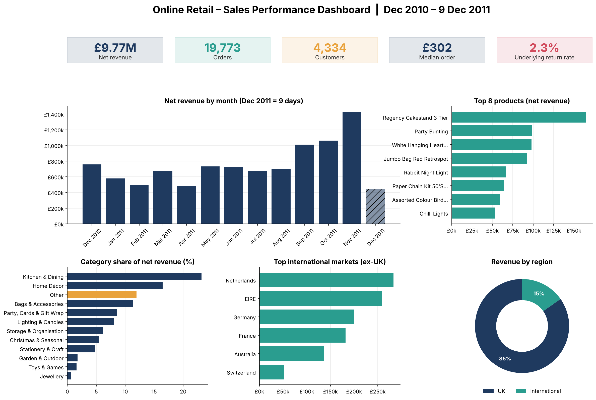

# Business Sales Performance Analytics
**Future Interns · Data Science & Analytics Internship · Task 1** (`FUTURE_DS_01`)

An end-to-end analysis of a UK online retailer's transactions to uncover **revenue trends, top-selling products, high-value categories and regional performance**, finishing with prioritised, evidence-backed recommendations.



## Deliverables
| File | What it is |
|---|---|
| [`reports/Sales_Performance_Report.pdf`](reports/Sales_Performance_Report.pdf) | Client-ready 5-page report: executive summary, insights, recommendations |
| [`notebooks/01_sales_performance_analysis.ipynb`](notebooks/01_sales_performance_analysis.ipynb) | Full, reproducible analysis (cleaning → KPIs → insights → recommendations) |
| [`images/`](images) | Dashboard and charts used in the report |
| [`outputs/`](outputs) | Summary tables (monthly, product, category, country) and `kpis.json` |

## Dataset
[Online Retail Dataset (Kaggle)](https://www.kaggle.com/datasets/ulrikthygepedersen/online-retail-dataset): 541,909 line items, 1 Dec 2010 – 9 Dec 2011, 38 countries. The raw file is not committed – see [`data/README.md`](data/README.md).

## Approach
1. **Audit** – duplicates, cancellations, zero prices, missing IDs, non-product codes.
2. **Clean (with row accounting)** – removed 5,268 duplicates and 2,995 non-product lines (postage, fees, manual entries); separated returns from sales; standardised product descriptions.
3. **Define KPIs** – gross revenue, returns, **net revenue** (gross − returns), AOV, return rate.
4. **Analyse** – monthly trend & like-for-like comparison, weekday/hour patterns, product ranking & Pareto, keyword-derived categories & seasonality, country performance, customer concentration, returns.
5. **Recommend** – seven actions, each tied to a number from the data.

## Key findings
| Area | Finding |
|---|---|
| Revenue | **£9.77M net** (£10.25M gross, 4.6% recorded returns) from 19,773 orders and 4,334 customers |
| Seasonality | Sep–Nov = **41%** of Jan–Nov revenue; November is **2.3×** the Jan–Aug monthly average. Like-for-like 1–9 Dec: **+10%** YoY |
| Products | Top 10 = 8% of revenue; **22%** of products (840) deliver 80% – demand is broad, not hero-driven |
| Categories | **Kitchen & Dining** leads (23%); top 3 categories = 52% |
| Regions | UK = **85%**; international 15%, led by Netherlands, EIRE, Germany, France, Australia |
| Customers | Top 10% of customers = **60%** of revenue; repeat customers = 94% of revenue |
| Data quality | Two orders worth £246k were cancelled minutes after being placed – they would top a naive best-seller list. Underlying return rate is **2.3%** |

### A note on data quality that changes the story
The two largest "sales" in the file (80,995 × *Paper Craft, Little Birdie* and 74,215 × *Medium Ceramic Top Storage Jar*) were each cancelled within minutes. Ranking products on gross sales would crown them best-sellers and December 2011 would show a 28% return rate. Every ranking and headline figure here is therefore based on **net** revenue, and return-rate analysis is shown on an *underlying* basis.

## Recommendations (summary)
1. Pre-build Q4 stock and logistics capacity by July/August.
2. Adopt a tiered (ABC) stock policy around the ~840 products that deliver 80% of revenue.
3. Introduce account management for wholesale-style, high-value customers.
4. Grow internationally with two playbooks: protect account-driven markets (Netherlands, Australia, EIRE); replicate broad-base markets (Germany, France).
5. Add validation for very large single-line orders.
6. Record a reason code on every cancellation to separate returns from order amendments.
7. Make customer ID mandatory to enable retention / CLV analysis.

## Limitations
* One year of data, with a partial final month – seasonality rests on a single cycle.
* Product categories are **inferred from descriptions** (no category field exists); ~12% of revenue is unclassified.
* No cost/margin data – "high-value" means high revenue, not high profit.
* Customer metrics cover identified customers only (~85% of revenue).

## Reproduce
```bash
git clone https://github.com/Chetankumar0/FUTURE_DS_01.git
cd FUTURE_DS_01
pip install -r requirements.txt
# download the dataset into data/online_retail.csv (see data/README.md)
jupyter notebook notebooks/01_sales_performance_analysis.ipynb
```

## Tools
Python · pandas · NumPy · matplotlib · seaborn · Jupyter · ReportLab (PDF report)
